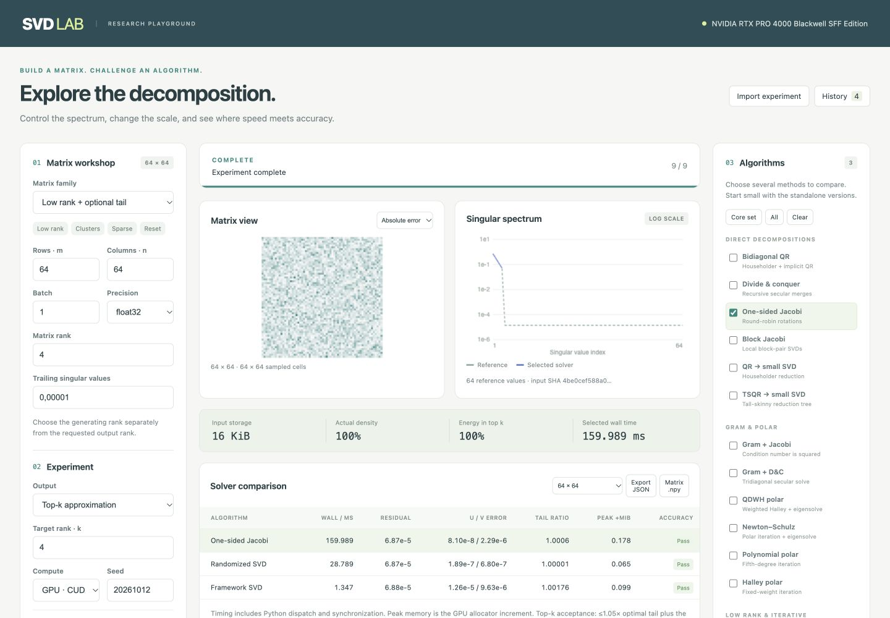

# SVD Lab — write an SVD, run it, see its accuracy and speed

Write a singular value decomposition, or one step of an existing one, in Python, C++ or
CUDA. One command builds it, runs it on a fixed set of test matrices on CPU or GPU and
reports reconstruction, orthogonality and singular-value errors against an FP64
reference, a pass/fail verdict per matrix and the median time.

## Quickstart

```bash
python -m pip install -e .                                   # once, from the repository root
python -m svdlab check examples/my_svd.py --quick            # a working starter SVD, small matrices
```

Your SVD is a function in a file:

```python
def svd(a, rank):          # a: torch tensor (m, n), real or complex; rank <= min(m, n)
    ...
    return U, s, Vh        # (m, k), (k,), (k, n) with k >= rank; torch or NumPy
```

```bash
cp examples/my_svd.py my_svd.py                              # edit the body
python -m svdlab check my_svd.py --compare torch             # 8 standard matrices, next to torch
python -m svdlab check my_svd.py --device cuda               # the same on the GPU
python -m svdlab check my_svd.py --gpu-check                 # CPU vs GPU: same answers, really on the GPU
python -m svdlab check my_svd.py --csv results.csv           # keep every number
python -m svdlab list                                        # builtin methods, building blocks, matrices
```

| You want to | Start from |
| --- | --- |
| Write a whole SVD in Python | [examples/my_svd.py](examples/my_svd.py) |
| Replace one step (QR, bidiagonalization, small SVD, ...) of an existing SVD | [examples/replace_a_step.py](examples/replace_a_step.py), [examples/lanczos_then_bdsqr.py](examples/lanczos_then_bdsqr.py), [svdlab/recipes.py](svdlab/recipes.py), [svdlab/blocks.py](svdlab/blocks.py) |
| Write it in C++ (CPU and GPU through ATen) | [examples/native/my_svd.cpp](examples/native/my_svd.cpp) |
| Write your own CUDA kernel | [examples/native/my_svd.cu](examples/native/my_svd.cu) |
| Use it from Python or a notebook, with your own matrices | [examples/from_python.py](examples/from_python.py), [my_svd.ipynb](algorithm_laboratory/my_svd.ipynb) |

`.cpp`/`.cu` files are compiled on first use with `torch.utils.cpp_extension` (no CMake) and
cached until they change. They need `pip install ninja`, the Python headers (`sudo apt install python3-dev`), a C++ compiler and, for `.cu`, nvcc from the CUDA toolkit.

New here? Follow the [tutorials](docs/tutorials/README.md) and run the matching
[quickstart notebooks](notebooks/) (CPU is enough; a GPU is used when present).

The [developer guide](docs/DEVELOPER_GUIDE.md) has the function contract, every option,
the list of building blocks, how the verdict is decided and troubleshooting.

### What the numbers mean

| Column | Meaning |
| --- | --- |
| `ok` / `FAIL` | orthogonality and reconstruction within 100·eps·max(m, n) of the input dtype; for a truncated SVD the residual within 1.05× the best possible rank-k residual |
| `recon` | ‖A − U diag(s) Vᴴ‖ / ‖A‖ |
| `tail×` | residual divided by the optimal (Eckart–Young) one, truncated cases only |
| `σ-rel` | largest relative error of a singular value above the FP64 noise floor |
| `orth` | max(‖UᴴU − I‖, ‖V Vᴴ − I‖) / √k |
| `ms` | median time of the call alone: input already on the device, warm, nothing else timed |

A failing case does not stop the others; its error is printed. The exit code is 1 when a
checked method fails a case, so the command works in CI.

### Where things are

| Path | What it is |
| --- | --- |
| `svdlab/` | The front door: `check`, the command line, `blocks` (QR, Householder and Lanczos bidiagonalization, bdsqr, Jacobi, ...), `recipes` (Golub–Kahan, QR + SVD, randomized, Lanczos, Jacobi), `native` |
| `examples/` | Templates to copy |
| `docs/tutorials/`, `notebooks/` | Step-by-step tutorials for new developers and the matching notebooks |
| `tests/` | `python -m unittest discover -s tests` (`SVD_TEST_DEVICE=cuda` for the GPU) |
| `svdbench/standalone/` | The 16 repository SVD implementations and their primitives, which `svdlab.blocks` exposes |
| `algorithm_laboratory/` | Step-by-step tracing of an algorithm: checkpoints, intermediate arrays, parameter studies |
| `svdbench/playground/` | Web playground for interactive comparisons |
| `svdbench/`, `configs/`, `tools/`, `results/`, `docs/` | Research benchmark harness, saved measurements and reports |

---

# Research and benchmarks

The rest of the repository is a reproducible laboratory for choosing and investigating SVD
methods under accuracy, runtime and memory constraints: editable standalone solvers,
vendor-library controls, an interactive playground and saved benchmark evidence.

## Questions this project helps answer

| Question | Evidence produced |
| --- | --- |
| Which method fits a matrix shape, spectrum and requested rank? | Workload-specific comparisons with explicit accuracy gates |
| Is a faster result accurate enough for the application? | Reconstruction, orthogonality, spectrum and subspace checks |
| Where does GPU time or memory go? | Separate resident/end-to-end timings, allocator peaks and profiling |
| How does an algorithm behave internally? | Editable implementations, checkpoints and iteration diagnostics |

## Selected benchmark evidence

The [larger-workload report](docs/BROAD_RESULTS.md) contains **166 distinct
method/workload settings across 14 workloads**, including matrices up to
8192 × 2048. Of these settings, 91 passed the declared accuracy budget;
completed calls that failed accuracy checks, timeouts and numerical errors
remain in the report.

On the recorded NVIDIA RTX PRO 4000 Blackwell SFF setup:

- For the **8192 × 2048 low-rank input, top 64**, randomized SVD using library
  QR/SVD primitives took **6.509 ms** with **107.78 MiB** peak Torch-allocated GPU
  memory and a reconstruction residual **1.000007× the optimal discarded tail**.
- cuSOLVER QR passed all **eight full-spectrum workloads** tested, providing a
  useful accuracy baseline for that suite.
- The **16 standalone solver variants** provide editable numerical baselines.
  Their unfused Python implementations are generally much slower than cuSOLVER;
  they should not be presented as production GPU speedups.

These are workload-specific measurements, not a universal method ranking.
The report gives hardware, acceptance budgets, timing methodology and memory
coverage. CPU and NVIDIA CUDA runs are documented; AMD and Ascend hardware
validation remains outstanding.

## Choose a starting point

| Goal | Start here |
| --- | --- |
| Review findings and measurement limits | [Larger-workload results](docs/BROAD_RESULTS.md) · [Initial results](docs/RESULTS.md) |
| Explore matrices and compare methods interactively | [Playground guide](docs/PLAYGROUND.md) |
| Write your own SVD and check it | [Quickstart](#quickstart) · [Developer guide](docs/DEVELOPER_GUIDE.md) |
| Edit an algorithm and inspect intermediate steps | [Algorithm laboratory](algorithm_laboratory/README.md) · [Manual](docs/ALGORITHM_LABORATORY.md) |
| Use the standalone solver interface | [Implementation/API guide](docs/STANDALONE.md) · [Measured results](docs/STANDALONE_RESULTS.md) |
| Reproduce or extend the larger suite | [Benchmark guide](docs/BROAD_BENCHMARK.md) |

## Algorithm laboratory and playground

To check an SVD, use `svdlab` ([Quickstart](#quickstart)). To trace the inside of an
algorithm step by step, use the [algorithm laboratory](algorithm_laboratory/README.md).
It provides editable algorithms, prepared matrices, checkpoints with intermediate
arrays, iteration diagnostics, independent timings, parameter studies and power
sampling. Edit [my_algorithm.py](algorithm_laboratory/my_algorithm.py) and run:

```bash
python -m algorithm_laboratory.experiment --algorithm mine
```

See the [laboratory manual](docs/ALGORITHM_LABORATORY.md) or open the
[working notebook](algorithm_laboratory/laboratory.ipynb). The web playground is
also available:

Compare 16 standalone SVD algorithms and vendor controls on matrices you design:
change sizes, rank, clustered singular values, sparsity, batches and precision.
Inspect heatmaps, spectra, reconstruction error, timing and GPU memory; save and
reload experiments or run a size sweep.

```bash
python -m pip install -e .
python -m svdbench.playground.server
```

Open **http://127.0.0.1:8765**. See the [playground guide](docs/PLAYGROUND.md) for the
Hetzner GPU connection, example experiments, accuracy gates and implementation.
[Importable presets](configs/playground) provide starting configurations.

The [larger-matrix Hetzner benchmark](docs/BROAD_RESULTS.md) adds 166 method/workload
comparisons on dense, low-rank, clustered and sparse inputs up to 8192×2048,
with separate speed, memory and accuracy rankings.
[Reproduce or modify the suite](docs/BROAD_BENCHMARK.md).



This repository includes the source, exact matrix corpus, raw results, reports and
logs downloaded from the research servers. Dependency environments are installed
separately. AMD/Ascend hardware validation remains outstanding.

---

## Standalone implementations

The standalone solver package is implemented and tested on Hetzner. Start with
[the implementation/API guide](docs/STANDALONE.md) and
[the measured results](docs/STANDALONE_RESULTS.md).
There are 16 matrix solver variants plus matrix updates and tensor decompositions,
with no vendor factorization calls inside `svdbench/standalone/`.

The results include 226 GPU matrix comparisons, 65 CPU controls, and 10 GPU application
benchmarks. These are editable numerical baselines; the unfused Python implementations
are generally much slower than cuSOLVER. See the accuracy gates and profiling evidence
before interpreting performance.

---

## Research bench and methodology

Initial hardware audit and experiments: **11 October 2026**. The research assessment is in
[docs/RESEARCH.md](docs/RESEARCH.md); the measured comparisons are in
[docs/RESULTS.md](docs/RESULTS.md). This is a tested starting point for comparative research,
not a completed survey or a validated implementation for every accelerator.

The Python harness separates input generation, algorithm preparation, execution, transfers,
and CPU validation. It runs on CPU and NVIDIA CUDA. Its portable Torch algorithms can also
target a ROCm build; AMD hardware has not yet been tested. NPU execution is explicitly
experimental and needs operator-placement verification. There is no implemented Ascend C
kernel or automatic CUDA/HIP/Ascend C translator.

## Run

Choose the correct PyTorch build for the target device before installing the package.
Do not install a CUDA build over an existing ROCm/NPU environment.

```bash
python -m pip install -e .
python -m unittest discover -s tests -v
python -m svdbench --config configs/smoke.json --device cpu \
  --output results/my-cpu.jsonl --corpus corpus/smoke --end-to-end
python -m svdbench --config configs/pilot.json --device cuda:0 \
  --output results/my-gpu.jsonl --corpus corpus/pilot --end-to-end
python -m svdbench --config configs/native.json --device cuda:0 \
  --output results/my-native.jsonl --corpus corpus/pilot --end-to-end
python tools/summarize.py results/my-gpu.jsonl results/my-native.jsonl
```

Results are created exclusively: choose a new output filename for each run. Configurations
are JSON. `--only` filters algorithms by name. ROCm uses the `cuda:0` device spelling too;
use `configs/smoke.json` or `configs/cpu.json` for portable methods. Explicit `gesvd*`
driver selection in this harness is NVIDIA-only; a direct rocSOLVER binding remains to do.

`--corpus DIR` generates missing `.npy` matrices or loads existing ones. **Copy that directory
between hosts**; a seed alone does not guarantee identical rounding across BLAS implementations.
Every record includes a SHA-256 of the actual input bytes. Existing corpus files must have
the configured shape/dtype; do not reuse a case name for a changed spectrum or seed.

The native bridge needs the source checkout, including the unmodified binding snapshot in
`references/hetzner-cusolver_direct.py`. That snapshot comes from the user's pre-existing
Hetzner project, not from NVIDIA. Its checksum and loaded library version are recorded.
The bridge bounds its known excessive randomized-output allocation at 512 MiB. It has not
fixed the original wrapper, and an allocation failure there is not a vendor workspace limit.

## What is measured

- Resident solver: warm-up followed by synchronized wall time and CUDA/HIP stream events.
  Events include stream gaps caused by host dispatch; they are not a sum of kernel durations.
  No CUDA graph replay is used, on either vendor or custom paths.
- End-to-end: CPU input copy, algorithm preparation, solve, and CPU output copies. This uses
  ordinary host memory, not a tuned pinned-memory pipeline. Corpus generation, CPU reference
  SVD, and validation are excluded.
- Memory: input/output bytes, PyTorch allocated and reserved peaks, and incremental peak above
  resident input/preparation. Native allocations outside the allocator are not measured.
  `native_workspace_bytes: null` means **unknown**, not zero.
- Optional 200 ms NVIDIA telemetry via `tools/run_monitored.py`: utilization, memory, power,
  temperatures and clocks. These are coarse whole-device observations, not per-call energy
  or occupancy measurements.
- Accuracy: reconstruction, both orthogonality errors, left/right singular-triplet residuals,
  singular-value error, and rank-k residual divided by the optimal FP64 tail. Cluster-aware
  subspace comparison avoids comparing arbitrary signs/phases or cuts through repeated values.

`status: ok` means the call completed and returned finite values. It does **not** mean every
accuracy metric passed a tolerance. The polar supplement demonstrates why this distinction
matters. Compare time only after applying the accuracy budget relevant to your application.

For example, to apply an **illustrative**, application-chosen acceptance budget to saved
vector-producing results (values-only rows will be marked unassessed):

```bash
python tools/assess.py results/my-gpu.jsonl \
  --max-residual 1e-3 --max-orthogonality 1e-3 --max-spectrum-over-sigma1 1e-3 \
  --output results/my-assessment.json
```

This example does not impose a small-singular-value relative error budget or a task-specific
loss budget. Those metrics still need to be inspected for the intended workload.

References use SciPy LAPACK `gesvd` in float64/complex128 on the **rounded input actually sent
to the device**. Values below its dimension-scaled FP64 reference floor are excluded from
the relative spectrum metric. This is a reference-resolution floor, not a promise of FP32
relative accuracy. The reference is not arbitrary precision. Validation stores per-matrix
metrics and worst cases across a batch; large problems will need scalable residual estimators.

## Modify an algorithm

The main readable implementations are in `svdbench/algorithms.py`:

- QR followed by a smaller SVD, including wide matrices via the adjoint;
- randomized range finding with QR reorthogonalization at every power iteration;
- a deliberately exposed Gram/eigendecomposition baseline, including its null-space failure;
- explicit PyTorch cuSOLVER drivers and full/reduced/values-only output modes.

These compositions call vendor QR/SVD/GEMM primitives. They are algorithm prototypes,
not independent implementations of those primitives. The older Hetzner project already
contains vendor-free NumPy/PyTorch reconstructions and fused Triton experiments; use those
as the starting material for deeper kernel work after auditing their metrics.

For a custom implementation, set `name` to `your_module:make_solver`. The factory receives
`(device_tensor, algorithm_spec)` and returns a zero-argument callable producing `(U, s, Vh)`.
The callable must preserve the input across repeated runs, use the current stream/device,
and report unsupported cases rather than silently transferring computation to the CPU.
Native wrappers should query workspace in preparation and restore any overwritten input.
Optional `metadata` and `diagnostics` attributes are saved with the measurement.

Port the computational primitives to CUDA C++/cuBLAS, HIP C++/rocBLAS, or Ascend C/CANN
behind this interface. Keep generators, configs, reference checks, and result schemas shared.
Re-run a custom factory for every end-to-end trial so its setup cost remains visible.

## Benchmark provenance

Raw measurements, environment metadata, source checksums and telemetry are in
`results/`. The initial diagnostic run exposed a complex-conjugate conversion
bug; research tables use the corrected `local-smoke-verified.jsonl` run and the
named server experiments. Refer to each result report for the hardware and
environment used.

## Author and contact

[Pavel Uydanov](https://github.com/upv) ·
[LinkedIn — project and R&D enquiries](https://www.linkedin.com/in/pavel-uydanov/)

Related work: [WirelessNN](https://github.com/upv/WirelessNN), a 5G NR uplink
receiver and channel-estimation research simulator.
