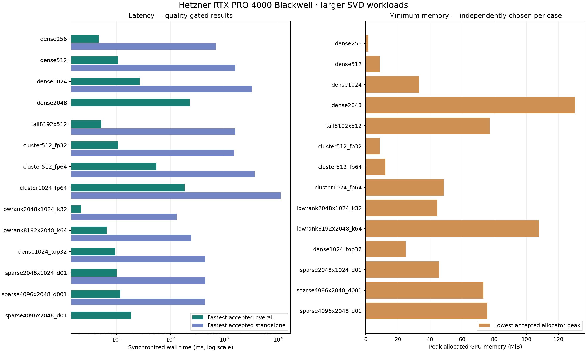
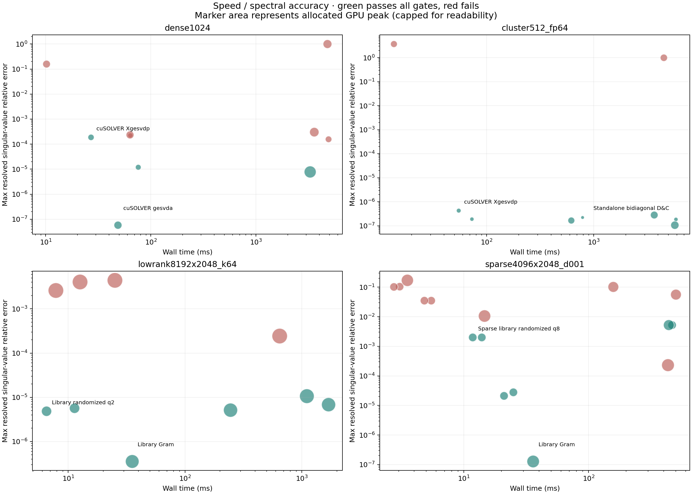

# Larger SVD workloads on Hetzner — 12 October 2026

**Randomized SVD with library QR/SVD primitives wins both speed and memory on the
two low-rank workloads.** Full-spectrum winners depend on shape and conditioning:
native cuSOLVER `Xgesvdp` wins the smaller square and clustered cases, the Gram
composition wins the tall well-conditioned case, and `gesvda` wins the 2048-square
Gaussian case. cuSOLVER QR (`gesvd`) is the most consistent full-spectrum baseline:
it passes all eight full-spectrum workloads tested.

This run contains **166 distinct method/workload settings on 14 workloads**, from
169 attempts. There are 13 distinct inputs: dense 1024² is shared by its full and
top-32 cases. Of the distinct settings, 161 completed, 91 passed the accuracy
budget, 70 completed but failed it, four hit a worker timeout, and one raised a
numerical error. Every failure is retained. The full set of 16 standalone variants
was attempted at 256×256; larger cases use selected families and library controls.

Hardware: NVIDIA RTX PRO 4000 Blackwell SFF, 24 GB, 70 W power limit; Intel i5-13500;
Torch 2.14.1+cu130. These are NVIDIA measurements; AMD and Ascend are untested.

## Speed and memory

Only methods passing the declared quality budget can win. Times below are medians
of three resident GPU solves after one warmup. The memory column belongs to the
**same speed winner**, not a different method with a smaller footprint.

| Input and requested output | Fastest accepted implementation | Time, ms | Peak allocated GPU memory, MiB |
|---|---|---:|---:|
| Dense Gaussian 1024×1024, all singular triplets, FP32 | cuSOLVER Xgesvdp | 26.830 | 40.01 |
| Dense Gaussian 2048×2048, all, FP32 | cuSOLVER gesvda | 228.791 | 258.29 |
| Tall Gaussian 8192×512, all, FP32 | Gram + library eigensolver | 5.167 | 97.01 |
| Clustered 512×512, condition 1e10, all, FP64 | cuSOLVER Xgesvdp | 54.938 | 22.02 |
| Clustered 1024×1024, condition 1e6, all, FP64 | cuSOLVER Xgesvdp | 184.375 | 78.54 |
| Low-rank 2048×1024, top 32, FP32 | Library randomized, q=2 | 2.178 | 44.51 |
| Low-rank 8192×2048, top 64, FP32 | Library randomized, q=2 | 6.509 | 107.78 |
| Sparse 2048×1024, 1% density, top 32, FP32 | Gram + library eigensolver | 10.021 | 64.63 |
| Sparse 4096×2048, 0.1% density, top 32, FP32 | Sparse library randomized, q=8 | 11.781 | 73.58 |
| Sparse 4096×2048, 1% density, top 64, FP32 | Dense library randomized, q=8 | 18.512 | 75.63 |

Here q is the number of power iterations. The q=2 library runs use 16 oversampling
columns; the q=8 follow-up runs use 64. Both parameters changed, so this does not
isolate the effect of q. “All” means all min(m,n) singular triplets, using reduced
factors rather than completing the rectangular null-space basis.

Memory and speed often prefer different implementations:

- **Low-rank:** library randomized q=2 wins both metrics on both inputs.
- **Dense 2048²:** cuSOLVER QR uses **130.30 MiB** at **324.684 ms**, versus
  258.29 MiB and 228.791 ms for gesvda. It approximately halves measured memory.
- **Tall 8192×512:** Xgesvdp uses **77.26 MiB** at **16.367 ms**, while the faster
  Gram path uses 97.01 MiB.
- **Clustered 1024² FP64:** cuSOLVER Jacobi uses **48.56 MiB** at **1875.155 ms**,
  versus 78.54 MiB and 184.375 ms for Xgesvdp.
- **Sparse 4096×2048 at 0.1%:** dense randomized q=8 has the smallest measured
  peak, **73.26 MiB**, at **13.880 ms**; sparse randomized q=8 is faster at 11.781 ms
  and 73.58 MiB. Different sketches were used; this is not a matched-sketch trial.

Memory means the Torch allocator peak during solves, including resident input,
outputs and Torch-visible workspace. CUDA context, driver allocations, CPU memory
and other allocations outside the allocator are excluded. Sparse methods perform
real COO products, but the harness also keeps a dense GPU input and dense CPU
reference. These measurements do **not** establish a pure sparse application's
minimum memory. The legacy Xgesvdr wrapper also allocates full square U/V buffers;
its footprint must not be described as an intrinsic cuSOLVER requirement.

## Accuracy and numerical failures

The reference is independent SciPy LAPACK `gesvd` in FP64 on the actual rounded
input, not on its ideal generating spectrum. Full FP32 acceptance requires
relative reconstruction, spectrum error divided by sigma1, and normalized U/V
orthogonality each ≤2e-4; FP64 requires ≤1e-9. Top-k requires reconstruction
≤1.05× the optimal discarded tail, leading singular-value relative error ≤1%,
and the same orthogonality limits. Tiny values below the reference resolution
floor are excluded from the relative spectrum metric.

**For general full decompositions, use cuSOLVER QR as the accuracy baseline.** It
passed every full-spectrum case attempted. The faster Xgesvdp path passed seven
of eight, but on dense 2048² returned relative reconstruction error **53.95** despite
`info=0`. Its reported `h_err_sigma` was **53.93**. NVIDIA documents that this output
describes the perturbation applied to singular values; it must be inspected along
with residuals. The cause of this particular result has not been isolated to the
library, wrapper or configuration. [NVIDIA cuSOLVER documentation](https://docs.nvidia.com/cuda/cusolver/)

**The smallest observed errors on the Gaussian FP32 cases came from the gesvda
path**, with reconstruction about 4.3e-8 and maximum resolved singular-value
relative error about 5.3–5.9e-8. That is workload-specific: it failed to converge
on the FP64 clustered condition-1e10 case. Gram methods also failed the full
clustered cases, especially their orthogonality gates. Forming AᴴA squares the
condition number; their success on tall well-conditioned or leading-subspace
tasks is not evidence for preserving tiny singular values.

**On low-rank inputs, randomized q=2 is already sufficiently accurate.** For
8192×2048, top 64, its residual is **1.000007×** the optimal tail and its maximum
leading singular-value relative error is **4.90e-6**. The Gram composition has a
smaller measured spectrum error (**3.58e-7**) but takes **35.200 ms** and
**194.01 MiB**, compared with 6.509 ms and 107.78 MiB. Differences close to the
reference/precision floor should not be treated as reliable superiority.

**Flat-spectrum and random sparse inputs need more subspace work.** The original
q=2 and q=4 randomized controls failed the 1% leading-value budget on these cases,
even when reconstruction was close to the optimal rank-k residual. Increasing q
and oversampling brought several configurations within budget. At 0.1% density,
sparse q=8 achieved **0.203%** maximum leading-value error; dense q=8 at 1% density
achieved **0.940%**. Gram gave the smallest observed spectrum errors on all tested
top-k workloads, but usually took more time and memory than accepted randomized
methods.

Random sparsity does not imply low numerical rank: the optimal top-k residual is
still about 95–96% of the input Frobenius norm on these sparse cases. A large
absolute reconstruction error here mostly reflects the requested truncation.

Several Jacobi results narrowly miss the strict FP32 orthogonality budget. A
secondary analysis relaxing the full FP32 gates to 1e-3 leaves the fastest winners
unchanged; the complete report shows both budgets. The clustered FP64 reference
is not arbitrary precision, so tiny relative-error differences are not definitive.

## What this means for the standalone implementations

The fastest accepted standalone variant is **37–309× slower** than the fastest
accepted library implementation on cases with a standalone pass. These are
unfused Python/Torch implementations; the experiment compares current programs,
not an inherent limit of their mathematical algorithms.

Standalone bidiagonal D&C is the fastest accepted standalone on dense 512 and
1024 and clustered FP32. Standalone randomized/subspace methods lead on the
low-rank cases. Standalone dense Lanczos leads among accepted standalone methods
on the flat top-32 and the two easier sparse cases. No standalone method tested
passed at dense 2048² or sparse 4096×2048, 1% density, top 64 under this budget.
The two selected standalone dense-2048 methods timed out; this is not a proof that
they cannot converge with a larger worker budget.

The most useful next optimization target is the standalone randomized/subspace
path: fuse its orthogonalization and reductions, preserve the declared accuracy
budget, then compare against the 2.178/6.509 ms library baselines. For sparse work,
remove the retained dense representation in a separate memory experiment and use
matched random sketches. Check multiple seeds before adopting close winners.

## Reproducibility and saved artifacts

The main run has 143 attempts. The 26-attempt supplement retries three initial
Xgesvdp setup failures after restoring the existing binding file, adds the
dense-2048 gesvda control, and tunes randomized controls on the **same cached
inputs**. The latest attempt replaces only the three retried settings in the
ranking; all original attempts remain in the raw records.

One input seed, one accuracy solve and three timing samples per setting do not
establish universal or statistically significant rankings. Solver timing excludes
generation, CPU references, transfers, preparation and validation. Library sketch
generation is prepared outside the timer; standalone implementations retain their
own existing preparation behavior. TF32 was disabled and worker thread pools were
limited to four. The 60-second timeout covers the **whole worker**, not one SVD.

- [All 14 workload rankings, accuracy metrics and failures](../results/broad-20261012/BROAD_RESULTS.md)
- [Reproduction commands and measurement contract](BROAD_BENCHMARK.md)
- [Main measurements](../results/broad-20261012/measurements.jsonl),
  [follow-up measurements](../results/broad-20261012/supplement-measurements.jsonl),
  [machine-readable winners](../results/broad-20261012/summary.json)
- [Environment](../results/broad-20261012/environment.json),
  [verified matrix/source hashes](../results/broad-20261012/integrity.json),
  [31-test passing log](../results/broad-20261012/broad-tests.log)

Full matrices and FP64 factors were downloaded into the local source checkout's
`experiments/broad-20261012` and `experiments/broad-20261012-supplement`; copies remain
under `/root/svd-standalone-20261011/experiments/` on Hetzner. These large arrays are
excluded from Git. Configurations, source, measurements, logs and plots are tracked.
All 14 input hashes, supplement copies and the solver-source fingerprint were
verified after downloading. The playground service has been restored.
