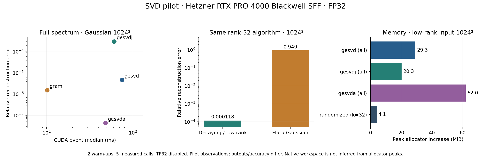

# Measured pilot results — 11 October 2026

**Scope:** 184 GPU case/algorithm evaluations across two NVIDIA servers, plus five Hetzner
CPU controls. Each successful timing used two warm-ups and five measurements. All 14 shared
pilot matrix hashes match across hosts. FP32 matrix multiplication used `highest` precision
with TF32 disabled. Timing mode is ordinary calls with CUDA events, not CUDA graphs.
The tables below are pilot observations, not universal algorithm rankings.

Raw records: [Hetzner pilot](../results/hetzner-pilot.jsonl),
[Yadro pilot](../results/yadro-pilot.jsonl),
[Hetzner native](../results/hetzner-native.jsonl),
[Yadro native](../results/yadro-native.jsonl),
[CPU controls](../results/hetzner-cpu.jsonl), [flattened table](../results/summary.csv).

The 184 evaluations comprise 77 pilot and 15 native cases per GPU. Four evaluations raised
convergence errors. Of the 180 that returned finite outputs, several produced unacceptable
numerical results, especially the real-valued polar cases described below. `status=ok` in
the raw data is an execution status; it must not be used as an accuracy filter.



## Full spectrum and small batches

Hetzner, FP32, median CUDA-event milliseconds. Reconstruction is evaluated in FP64 against
the actual input. A small reconstruction residual alone is insufficient to certify the
small singular values or orthogonality.

| Matrix/task | Route | GPU event ms | Relative reconstruction error |
|---|---|---:|---:|
| 1024×1024 Gaussian, full spectrum | gesvd | 74.818 | 4.68e-6 |
| same | gesvdj | 60.921 | 3.03e-4 |
| same | gesvda | 48.269 | 4.31e-8 |
| same | Gram/eigh prototype | 10.174 | 1.54e-6 |
| 64 matrices of 32×32 | PyTorch default | 0.279 | 6.35e-6 worst matrix |
| same, direct native supplement | gesvdjBatched | 0.296 | 6.35e-6 worst matrix |
| same | gesvd through PyTorch | 36.845 | 1.13e-6 worst matrix |

The Gram prototype's maximum relative singular-value error on that Gaussian square was
about **9.38%**, despite its small reconstruction error. On the condition-1e6 construction
it reached **140%**. Therefore its faster time is not a substitute for an accuracy-matched
full SVD. Conversely, the vendor approximate API was much more accurate than the naive
FP32 Gram prototype on these inputs; algorithm-family descriptions do not establish the
actual internal precision or implementation of a vendor binary.

The tiny-batch result makes a stronger engineering point: API dispatch and batching can
matter more than the nominal mathematical family. Measure a whole batch and time per
matrix; never compare a Python loop of vendor calls with a fused kernel and attribute the
entire difference to mathematics.

## Top-k approximation

Synthetic 1024×1024 matrix with 32 dominant singular values (1 down to 0.1), then a 1e-5
tail, rounded to FP32. Requested k=32, oversampling=16, two power iterations.

| Hetzner route | Output | GPU event ms | End-to-end ms | Peak allocator increase MiB | Residual / optimal rank-32 tail |
|---|---|---:|---:|---:|---:|
| gesvd | All 1024 components | 79.065 | 85.140 | 29.27 | Not applicable to full output |
| gesvda | All 1024 components | 41.627 | 47.005 | 62.00 | Not applicable to full output |
| Python randomized composition | 32 components | 1.895 | 2.895 | 4.14 | 1.00021 |
| Native Xgesvdr through existing binding | 32 components | 2.580 | 3.245 | 19.48 | 5.82484 |

The custom randomized composition's relative reconstruction error was 1.176e-4, nearly
the best possible rank-32 error. This is a promising candidate for an AI compression
workload that accepts that error. The full-output rows perform more work and solve a
different problem, so this table is **not** a claim that an equivalent exact SVD is 40× faster.
The native randomized row needs its own accuracy tuning; the legacy adapter also allocates
full square output buffers, contributing to its memory footprint.

For a Gaussian 1024×1024 input, the same Python rank-32 method took 2.271 ms but left
**0.94866 relative reconstruction error**. It discarded most of a relatively flat spectrum.
Low latency is useful only when the application needs those 32 components rather than a
faithful reconstruction of the whole matrix.

These are one corpus seed and one sketch seed. Repeated calls measure timing variation,
not the statistical distribution of approximation quality. That distribution remains to test.

## Failures and independent native check

On each GPU, `gesvda` raised a convergence error for:

- The 256×256 FP64 construction with nominal condition number 1e12.
- The 256×256 FP32 construction with nominal rank 32 and zero prescribed tail.

Rounding a constructed low-rank matrix can introduce tiny nonzero singular values; the
reference was recomputed after rounding. These are errors on these inputs/builds, not an
assertion that the routine always fails on every ill-conditioned or rank-deficient matrix.

**Xgesvdp returned info=0 but did not give an acceptable full SVD on three real-valued
cases per host.** For the 512×512 Gaussian input, the legacy binding reported relative
reconstruction error 26.974 and perturbation `h_err_sigma=26.972`. The complex rectangular
case reconstructed accurately (about 1.25e-6), so successful small examples would miss this.

To remove Python and the old binding from the explanation, `tools/polar_sanity.cpp` was
compiled on Yadro using its system CUDA toolkit and linked to system cuSOLVER **12.2.2**.
It read the same FP32 input and reconstructed U*diag(s)*V^T using independent CPU loops.
It reproduced `info=0`, perturbation 26.97208, and relative error **26.97399**.
The workspace query returned **87,038,480 device bytes** and zero host bytes for that case.
[Raw independent check](../results/polar-system-check.json).

This validates an unacceptable numerical result on the tested input, architecture and
library versions. It does not establish the underlying cause or a general failure of polar
SVD. Exclude these rows from performance winners, retain the reproduction, and investigate
scaling/conditioning and other supported builds. Always inspect the perturbation and
reconstruction, not only `info`. No issue was filed externally.

Reproduction on Yadro (from its new research directory):

```bash
/usr/local/cuda/bin/nvcc -O2 tools/polar_sanity.cpp -lcusolver -o build/polar_sanity
# build/square512.bin contains corpus/pilot/square512_fp32.npy transposed then tofile().
LD_LIBRARY_PATH=/usr/local/cuda/lib64 ./build/polar_sanity build/square512.bin 512 512
```

## CPU controls and output choices

Hetzner CPU, four Torch/BLAS threads, ordinary synchronized wall time:

| Task | Method | Median ms |
|---|---|---:|
| Gaussian 1024×1024 | PyTorch full-spectrum reduced SVD | 63.960 |
| Low-rank 1024×1024 | PyTorch full-spectrum reduced SVD | 43.004 |
| Low-rank 1024×1024, rank 32 | Randomized composition | 3.298 |
| Batch 64×32×32 | PyTorch SVD | 4.504 |

These results justify keeping a CPU baseline: a GPU call is not automatically faster for
every small or moderate problem. They do not compare identical vendor implementations.
The randomized GPU solve's end-to-end 2.895 ms is much closer to the CPU's 3.298 ms than
resident GPU timing alone suggests.

For the 512×128 output-mode case, Hetzner `gesvd` needed 4.796 ms for reduced vectors
and 1.442 ms for values only. `gesvdj` used 3.538 versus 3.507 ms. Output semantics and
implementation determine the savings; do not assume values-only gives the same speedup
for every driver.

## Why Yadro is not a clean hardware ranking

Yadro is a four-vCPU VM and had another Python GPU process using about 2.95 GiB throughout
the pilot. Its sample latencies vary substantially. Framework versions differ slightly
between hosts. A 600 W, 96 GiB GPU's advertised capacity does not overcome host dispatch,
shared-resource interference, or algorithm-specific bottlenecks in every case.

Example: full-spectrum `gesvd` on the Gaussian 1024² matrix was 120.535 ms on Yadro versus
74.818 ms on Hetzner; `gesvda` was 30.712 versus 48.269 ms. This reversal warrants isolated
profiling. It is not evidence that one GPU architecture is universally faster.

The telemetry CSVs are whole-device samples every 200 ms and include the other Yadro
process. They cannot give per-SVD energy, individual-kernel utilization or reliable peak
memory for sub-millisecond calls. Driver workspaces outside the PyTorch allocator remain
unknown except for the independent C++ query above.

## Existing Hetzner work reviewed

The existing `/root/svdbench` project has NumPy algorithm reconstructions, direct CUDA
bindings, vendor-free prototypes, Triton kernels and tensor unfolding experiments. Its
Git HEAD was `d2225b8830a6ae437d9e38933f7079fd4a83bda4`, with existing uncommitted changes.
It was not modified. [Inspected binding snapshot](../references/hetzner-cusolver_direct.py).

Audit findings:

- Its randomized wrapper allocates full U/V arrays even when it requests top-k; the 512 GiB
  report follows directly from the m-by-m allocation, before the native solver is called.
  Validate a reduced allocation against the installed API and sanitizer before changing it.
- Graph-replay timings and ordinary-call timings must be presented separately for kernel
  speedup claims. End-to-end dispatch is also a legitimate metric, but needs its own label.
- A tiny beamforming loss can coexist with invalid small singular values or nonorthogonal
  full bases. Keep the task-specific claim and the full-SVD claim separate.
- Some old documentation gives overly broad claims such as one route always being fastest.
  The new measurements already show workload-dependent reversals and failures.

The new harness provides a broader common validation layer and can reuse those kernels;
it does not replace or certify the old project wholesale.

## Validation completed / still outstanding

Completed: ten numerical/assessment contract tests; 30 corrected local CPU smoke evaluations;
the two 77-case GPU pilots; two 15-case native supplements; five CPU controls; identical
input hashes across servers; independent C++ reproduction of the polar anomaly.

Outstanding: AMD hardware and direct rocSOLVER adapter; powered-on Ascend inspection and
native/hybrid kernels; matched-version isolated GPU runs; preallocated native timing and
complete workspace accounting; detailed profiler counters; multiple sketch seeds;
large/out-of-core and end-to-end tensor experiments; application-derived accuracy budgets.
