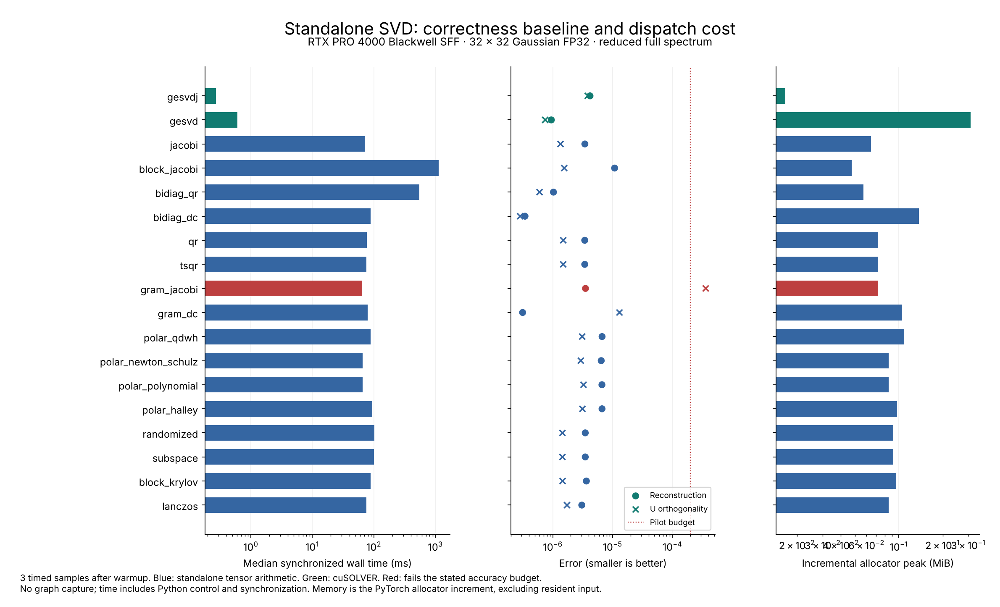

# Standalone SVD results — RTX PRO 4000 server, 11 October 2026

Implemented **16 matrix solver variants** spanning every family in the research table,
plus rank-one updates, column appends, HOSVD, ST-HOSVD and tensor-train SVD. The standalone
package uses tensor arithmetic and GEMM; it does not call vendor factorizations. The
implementation details, API, qualifications and rerun commands are in
[STANDALONE.md](STANDALONE.md).

The work is deployed at `/srv/svdlab`. The pre-existing
`/srv/gpubench` project was not changed. The CPU/GPU corpus, raw records, source snapshot,
test logs, review CSVs, telemetry and plot are also saved in the local project.

## What was measured

- **226 GPU matrix comparisons:** 200 standalone runs and 26 framework/vendor controls.
- **65 CPU matrix comparisons:** 60 standalone runs and five framework controls.
- **10 GPU application benchmarks:** nine standalone update/sparse/tensor workloads and
  one vendor recomputation control.
- **22 test methods**, with many shape/dtype/algorithm subcases, pass locally and on the RTX PRO 4000 server;
  the standalone tests use CUDA on the RTX PRO 4000 server. Tests independently compare with SciPy,
  check null bases, extreme scales, repeated poles, recursive merges, convergence failures,
  matrix-free callbacks, updates and tensor reconstruction. The factorization-call guard
  also passes.

Hardware: RTX PRO 4000 Blackwell SFF Edition, 24,467 MiB reported VRAM, 70 W power limit;
i5-13500; about 62 GiB host RAM. Runtime: Python 3.12.3 and Torch 2.14.1+cu130. Exact versions,
settings and hardware details are embedded in each JSONL header. Four CPU/GPU control
cases have identical input hashes. The benchmark source SHA-256 is
`d8eda2507f85b9d03ef3afeba90c0b094e378214714d7b72e8a3bad74d0a75fd` and matches the saved
`results/standalone-source-benchmark.tgz` archive.

Matrix workloads include square 32/64, tall 256×16 and 2048×32, wide complex 16×48,
eight independent 16×16 matrices, complex clustered spectra, FP64 condition numbers
10^8 and 10^12, FP32 rank deficiency, zeros, and 512×256 rank-8 approximations. Each
rank-8 standalone method is run with three seeds on both a decaying and a flat spectrum.

Timings are medians of three synchronized ordinary calls after warmup. Matrix generation
and reference computation are excluded. The main GPU run also records end-to-end time.
The scaling and application runs record resident timings. TF32 is disabled; there is no
CUDA graph replay. These small pilot sizes do not establish large-matrix performance.

## Accuracy

All **226 GPU matrix runs completed with finite outputs**. Under the explicit pilot gates,
**219/226 pass**. The seven failures are Gram methods: five `gram_jacobi` cases and two
`gram_dc` cases. The complete reasons are in `results/standalone-matrix-review.csv`.

The full-spectrum gates require relative reconstruction error, spectrum error divided by
sigma1, and normalized U/V orthogonality errors no larger than **2e-4 for FP32/complex64**
or **1e-9 for FP64/complex128**. Partial outputs instead require residual/best-rank-k-tail
no larger than **1.05**, plus the same orthogonality limits. Partial singular-value errors
are recorded but are not covered by that tail-error gate. These are declared experimental
budgets, not universal definitions of success. Small-value relative error is a separate
column and is not covered by an absolute spectrum-over-sigma1 gate.

Examples:

- FP64 condition 10^8: Gram-Jacobi reconstruction error is 3.48e-8, but U orthogonality
  error is **2.24e-3**. Looking only at reconstruction would conceal a serious defect for
  applications that need an orthonormal basis.
- FP64 condition 10^12: standalone bidiagonal QR reconstructs to **1.21e-15**; its maximum
  resolved singular-value relative error is about **6.40e-6**. Gram methods discard
  unresolved values and reach 100% relative error on some of them.
- Rank-8 low-rank 512×256: randomized/subspace residuals are **1.000009–1.000012 times**
  the optimal tail across three seeds. Block Krylov and Lanczos are also close to optimal.
- Flat-spectrum 512×256: rank-8 residual is about **0.96**, even when the residual/optimal-tail
  ratio is close to one. Keeping eight components cannot preserve most of this matrix.

The D&C diagnostics identify actual secular recursion and explicitly count Jacobi merge
refinements. For example, the 32×32 Gaussian case uses seven secular merges; the FP64
condition-10^12 case needs one Jacobi merge refinement. Do not interpret the latter timing
as a pure secular-merge implementation. All refinement remains standalone, on the same device.

## Speed and memory

The Python versions are much slower than cuSOLVER in these tests. This is the expected
starting point for an editable specification, but it is a measured limitation, not a speedup.
The table reports GPU synchronized wall time in milliseconds:

| Method | 32×32 FP32 | 64×64 FP32 | 2048×32 FP32 |
|---|---:|---:|---:|
| cuSOLVER Jacobi control | 0.274 | 0.990 | 0.669 |
| cuSOLVER QR control | 0.610 | 1.606 | 0.971 |
| Standalone one-sided Jacobi | 71.050 | 160.265 | 61.790 |
| Standalone bidiagonal QR | 548.666 | 2232.473 | 639.576 |
| Standalone bidiagonal D&C | 87.973 | 184.938 | 90.230 |
| Standalone Newton–Schulz + eigensolve | 65.494 | 149.023 | 65.039 |
| Standalone TSQR + small SVD | 76.096 | 171.914 | 251.257 |
| Standalone block Jacobi | 1134.212 | 6188.460 | 965.373 |

For rank-8 low-rank 512×256, the standalone randomized solver takes about **39.6 ms**,
versus **0.786 ms** for the existing framework-based randomized control. The inputs and
requested rank match, but the sketch generators differ; do not infer identical operation
sequences or numerical errors from these times.

CPU controls reinforce the dispatch limitation. Standalone 32×32 Jacobi takes **24.645 ms**
on the RTX PRO 4000 server CPU versus **71.050 ms** on its GPU. The CPU framework SVD control takes
**0.096 ms**. A large accelerator is not useful when thousands of very small operations are
launched individually.

An independent one-call profiler diagnostic on another seeded 32×32 FP32 matrix counted:

| Implementation | CUDA compute activity events |
|---|---:|
| Standalone one-sided Jacobi | 17,920 |
| Standalone bidiagonal QR | 124,633 |
| Standalone Newton–Schulz plus Jacobi eigensolve | 15,742 |
| cuSOLVER Jacobi control | 6 |

Memcpy/memset events are excluded from this compute count. Profiling adds overhead;
its timings are not used in the comparison table. The polar count also shows why a
GEMM-heavy polar iteration does not solve the whole performance problem: the remaining
standalone eigensolve still dispatches many tiny operations.

Incremental allocator peaks on 2048×32 FP32 range from roughly **0.76 MiB** for Gram-Jacobi
to **5.60 MiB** for block Krylov. Standalone D&C uses **1.52 MiB**, including its FP64
merge temporaries, and TSQR uses **1.33 MiB**. Input storage and output bytes are recorded
separately. These are PyTorch allocator measurements, not total process memory or queried
native workspace requirements; native controls can allocate outside that accounting.

## Updates, sparse operators and tensors

Application timings use FP64 resident data and exclude the initial factorization:

| Workload | Wall ms | Accuracy observation |
|---|---:|---|
| Rank-one update, initially rank 8, 128×96 | 16.385 | Reconstruction 1.45e-14 |
| Append four columns | 27.238 | Reconstruction 1.60e-14 |
| Warm subspace iteration | 33.185 | Optimal rank-8 tail to measured precision |
| Cold subspace iteration | 34.464 | Same tail accuracy; no convincing warm-start speed claim from three samples |
| Vendor full recomputation of updated matrix | 24.789 | Reconstruction 7.36e-14; produces a different, full-spectrum output |
| Twelve sequential truncated updates | 216.037 | Residual 1.01847× optimal final rank-12 tail |
| Matrix-free sparse Lanczos, top eight | 96.914 | Residual/optimal tail = 1.0 |
| HOSVD | 63.372 | Reconstruction 4.90e-15 |
| ST-HOSVD | 63.064 | Reconstruction 4.71e-15 |
| Tensor-train SVD | 38.557 | Reconstruction 2.44e-15 |

The synthetic Tucker tensor contains 1,920 scalars and its exact low-rank representation
stores 144 scalars. The TT example goes from 960 to 150 scalars. These are constructed
low-rank examples demonstrating implementation correctness, not compression guarantees
for arbitrary data. Unfolding shapes and materialization/storage information are saved.

## Recommended next experiment

Start by fusing **small one-sided Jacobi and its Hermitian eigensolver**. Keep these Python
implementations as the reference for each rotation, sweep and stopping condition. The
kernel-count diagnostic gives a concrete target, and the same eigensolver improvement
would help Gram and polar variants. Next optimize the small QR/solve and projected SVD
inside the randomized methods. Their accuracy is already promising on genuinely low-rank
inputs, but the current standalone timings do not justify a performance claim.

D&C is available for changing split sizes, deflation and secular solvers. Its FP64 merge
policy and optional Jacobi refinement must remain visible when comparing proposals.
Full GPU-native panel kernels, optimized rational secular solvers, graph capture, mixed
precision, and AMD/Ascend-native ports are subsequent optimization work. This delivery
implements the mathematical families and a tested modification bench; it does not claim
production-quality kernels or validation on the powered-off Ascend board.
